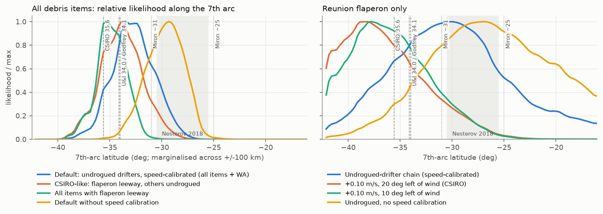
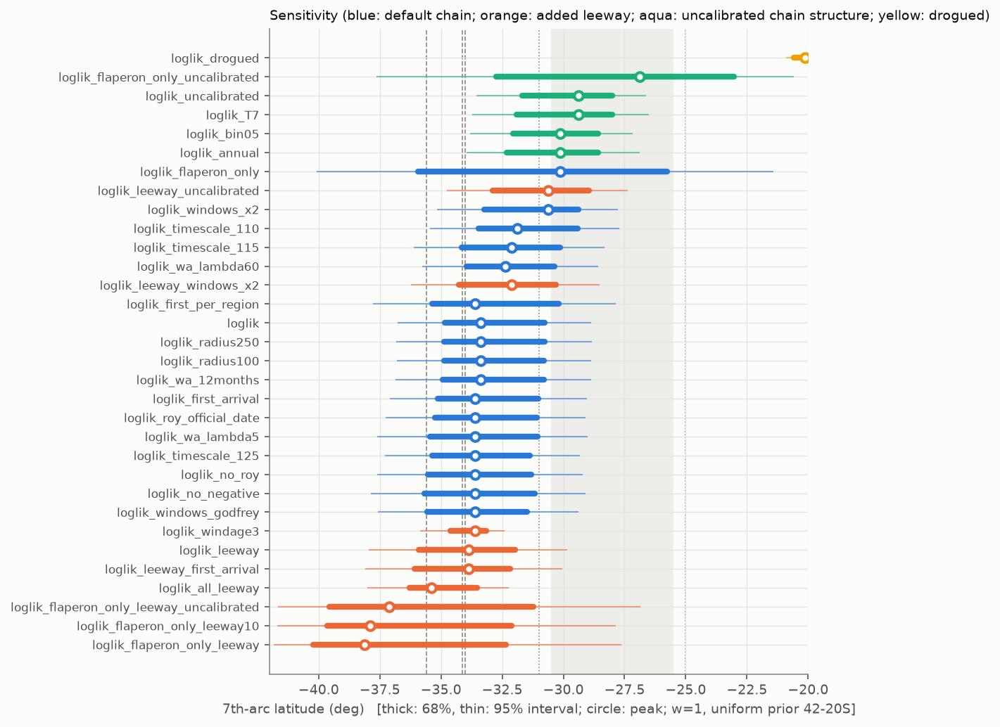

# Workstream B — drift: likelihood of the MH370 floating-debris evidence vs origin on the 7th arc

Independent, public-data-only reanalysis. Not authoritative. All latitudes below are °S on the
sea-level 7th arc. Every number in this file is produced by the scripts listed in §10.

## 1. Results in one page

**Deliverables**
* `data/derived/drift_loglik.nc`: `loglik` plus 31 whole-evidence variants `loglik_<variant>`,
  on the common 0.05° grid, NaN beyond 300 km of the arc. Also included: per-item fields
  `loglik_item_<key>` and `loglik_itemleeway_<key>`, the WA term `loglik_wa_term`, `p_wa`,
  `p_wa_leeway` and `dist_to_arc_km`.
* `arc_profile.csv`: every variant against arc latitude, marginalised over ±100 km across the arc.

**Model.** A Markov chain built from **undrogued NOAA GDP drifters**. It is calibrated so that
its westward transit speed matches held-out drifters. Its likelihood uses **15 debris
observations** (SIR-confirmed, "almost certain" or "highly likely" items found Jul 2015 to Jan 2017)
plus the **absence of finds in Western Australia**.

**Arc-latitude profile.** Columns:
* **peak**: latitude where the likelihood is highest.
* **mean**: mean latitude under a uniform prior along the arc, 42°S–20°S.
* **68% / 95%**: equal-tail intervals at w = 1.
* **68% (w=0.5)**: the 68% interval after tempering with w = 0.5.

| variant | peak | mean | 68% | 95% | 68% (w=0.5) |
|---|---|---|---|---|---|
| `loglik` | 33.4 | 32.7 | 30.8–34.9 | 28.9–36.8 | 30.0–35.6 |
| `loglik_leeway` | 33.9 | 33.8 | 32.0–35.9 | 29.9–37.9 | 31.1–36.6 |
| `loglik_all_leeway` | 35.4 | 34.8 | 33.5–36.3 | 32.3–38.0 | 33.0–37.1 |
| `loglik_no_negative` | 33.6 | 33.3 | 31.2–35.7 | 29.1–37.8 | 30.4–36.5 |
| `loglik_flaperon_only` | 30.1 | 30.7 | 25.8–35.9 | 21.4–40.0 | 24.7–37.1 |
| `loglik_flaperon_only_leeway` | 38.1 | 36.2 | 32.4–40.2 | 27.6–41.8 | 29.6–39.9 |
| `loglik_flaperon_only_leeway10` | 37.9 | 35.8 | 32.1–39.6 | 27.9–41.7 | 29.8–39.6 |
| `loglik_drogued` | 20.1 | 20.2 | 20.2–20.6 | 20.1–20.9 | 20.2–20.8 |
| `loglik_windage3` | 33.6 | 33.8 | 33.1–34.6 | 32.4–35.8 | 32.9–35.3 |
| `loglik_first_per_region` | 33.6 | 32.7 | 30.2–35.4 | 27.9–37.8 | 29.2–36.2 |
| `loglik_first_arrival` | 33.6 | 33.0 | 31.0–35.1 | 29.1–37.1 | 30.3–35.9 |
| `loglik_windows_x2` | 30.6 | 31.2 | 29.4–33.2 | 27.8–35.1 | 28.9–34.0 |
| `loglik_windows_godfrey` | 33.6 | 33.4 | 31.5–35.6 | 29.4–37.6 | 30.6–36.2 |
| `loglik_radius100` | 33.4 | 32.7 | 30.8–34.9 | 28.9–36.8 | 30.1–35.7 |
| `loglik_radius250` | 33.4 | 32.7 | 30.8–34.9 | 28.9–36.8 | 30.0–35.7 |
| `loglik_wa_lambda5` | 33.6 | 33.1 | 31.0–35.4 | 29.1–37.6 | 30.3–36.2 |
| `loglik_wa_lambda60` | 32.4 | 32.1 | 30.4–34.0 | 28.6–35.7 | 29.6–34.6 |
| `loglik_wa_12months` | 33.4 | 32.8 | 30.8–34.9 | 28.9–36.8 | 30.1–35.7 |
| `loglik_roy_official_date` | 33.6 | 33.0 | 31.1–35.2 | 29.1–37.2 | 30.3–36.0 |
| `loglik_no_roy` | 33.6 | 33.3 | 31.3–35.5 | 29.2–37.6 | 30.5–36.2 |
| `loglik_leeway_windows_x2` | 32.1 | 32.2 | 30.3–34.3 | 28.6–36.2 | 29.7–35.2 |
| `loglik_leeway_first_arrival` | 33.9 | 34.0 | 32.2–36.1 | 30.1–38.1 | 31.2–36.8 |
| `loglik_timescale_110` | 31.9 | 31.3 | 29.4–33.5 | 27.7–35.4 | 28.8–34.3 |
| `loglik_timescale_115` | 32.1 | 32.1 | 30.1–34.2 | 28.3–36.1 | 29.5–35.0 |
| `loglik_timescale_125` | 33.6 | 33.2 | 31.4–35.4 | 29.4–37.3 | 30.5–36.0 |
| `loglik_uncalibrated` | 29.4 | 29.7 | 28.0–31.7 | 26.6–33.5 | 27.5–32.5 |
| `loglik_leeway_uncalibrated` | 30.6 | 30.8 | 29.0–32.9 | 27.4–34.7 | 28.4–33.7 |
| `loglik_flaperon_only_uncalibrated` | 26.9 | 27.9 | 23.0–32.8 | 20.6–37.6 | 23.1–34.9 |
| `loglik_flaperon_only_leeway_uncalibrated` | 37.1 | 35.3 | 31.2–39.6 | 26.9–41.6 | 28.9–39.5 |
| `loglik_annual` | 30.1 | 30.3 | 28.6–32.3 | 26.9–33.9 | 27.9–33.0 |
| `loglik_bin05` | 30.1 | 30.2 | 28.6–32.1 | 27.2–33.8 | 28.1–32.9 |
| `loglik_T7` | 29.4 | 29.8 | 28.0–31.9 | 26.5–33.7 | 27.4–32.7 |

**Headline findings**
1. **The default layer (`loglik`) peaks at 33.4°S.** Its 68% interval is 30.8–34.9°S and its 95% interval 28.9–36.8°S.
   * It moves 0.3° or less under: the find-region radius (100–250 km), the WA window (12 months), λ = 5,
     the delay model (first-arrival vs presence), the official vs first-photo date for "Roy", dropping "Roy",
     and keeping only the first find per region.
   * λ = 60 moves it to 32.4°S, and doubling the reporting-delay windows moves it to 30.6°S.
2. **The north/south split in the literature is reproduced, and two modelling choices explain most of it.**
   * (a) **Flaperon leeway.** For the flaperon alone, the undrogued-drifter physics gives 30.1°S.
     CSIRO's measured flaperon leeway (+0.10 m/s, 20° left of the wind) gives 38.1°S; at 10° left
     it gives 37.9°S. That is a shift of about +8°.
   * (b) **Transit speed of the drift model.** A raw drifter Markov chain is ~20% too slow.
     Uncorrected, the all-item result is 29.4°S (Miron-like). Calibrated, it is 33.4°S. That is a shift of about +4°.
   * With both corrections (`loglik_leeway`, CSIRO-like physics) the peak is **33.9°S** (68%: 32.0–35.9°S).
     That sits on Ulich & Iannello's 34.0°S, Godfrey's 34.13°S and the ATSB's ~34°S.
   * Applying the flaperon leeway to every item (`loglik_all_leeway`) gives 35.4°S, close to CSIRO's 35.6°S.
3. **The debris finds disfavour the alternatives to CSIRO's assumption that generic debris drifts like an
   undrogued drifter.** The table compares arc-marginal log-likelihoods (`model_evidence.csv`).
   These are **not clean model evidence**. The debris-visit likelihood multiplies the items as if they
   were independent. They are not: items from one break-up share drift paths, and finds cluster by
   search effort and region. So the raw differences overstate the case. Read them as "disfavoured",
   and see the w = 0.5 column for the effect of the tempering used in the combination.

   | physics | Δ log-likelihood (raw, w = 1) | tempered (w = 0.5) | reading |
   |---|---|---|---|
   | 3% windage | −29 | −14.5 | disfavoured |
   | flaperon leeway for all items | −11 | −5.5 | disfavoured |
   | drogued drifters | −77 | −38.5 | strongly disfavoured (and physically wrong for floating debris) |
   | uncalibrated chain | −0.4 | −0.2 | indistinguishable on the debris alone; rejected by the held-out drifter validation |

   The flaperon find alone **cannot** tell its own leeway apart: −4.7 vs −5.0 nats. The leeway has to come from the field trial.
4. **A 2014–15 hindcast agrees with the chain on the flaperon.** It used HYCOM reanalysis currents, NCEP winds and 34,500 particles per physics variant.
   * With flaperon leeway, the Réunion window favours **36–41°S (peak 37°S)** and is under 1% north of 33°S.
   * With generic 1.2% windage it is flat from 26 to 39°S.
   * Its WA strandings are **banded** (13–21% at 37–41°S and 33°S; under 1% at 30–32°S; 3–6% at
     34–36°S), echoing CSIRO's finding. The climatological chain cannot produce that structure.
5. **Use a tempering weight w ≤ 0.5** when combining (§7). The 15 observations are strongly
   correlated: they share currents and winds, and five Mozambique finds sit within ~500 km of each other.




## 2. Data (all anonymous, no sign-up)

| Source | What | URL | Size here | Licence |
|---|---|---|---|---|
| NOAA Global Drifter Program, 6-hourly interpolated, ragged-array zarr, release "May 2025" (1979-02 .. 2025-06; 28,728 drifters) | positions, drogue status per fix, death code, velocities | https://noaa-oar-hourly-gdp-pds.s3.amazonaws.com/experimental/gdp6h_ragged_may25.zarr (doi:10.25921/7ntx-z961) | 0.95 GB (17 variables mirrored) | freely available (NOAA) |
| Natural Earth 1:10m land + minor islands | coastline / land mask | https://naciscdn.org/naturalearth/10m/physical/ | 11 MB | public domain |
| NCEP/NCAR Reanalysis 1, daily-mean 10 m winds 1985-2025 | winds along drifter tracks (leeway variants) and for the hindcast | https://psl.noaa.gov/thredds/fileServer/Datasets/ncep.reanalysis/Dailies/surface_gauss/ | 1.3 GB | public (NOAA PSL) |
| HYCOM GLBv0.08 expt_53.X reanalysis, surface u/v, daily 12Z, 8 Mar 2014 - 31 Aug 2015, 20-120E 50S-5N, every 3rd point | 2014-15 hindcast cross-check | https://tds.hycom.org/thredds/dodsC/GLBv0.08/expt_53.X/data/2014 (and /2015) | 0.15 GB | freely available (HYCOM consortium) |
| Debris catalogue | find dates/places, assessment class | Malaysia SIR 2018 Table 1.12A; ATSB debris-examination updates 1-5; Ulich & Iannello 2023 Table 3.2-1; Godfrey 2021 (URLs in `src/mh370/drift_debris.py`) | — | quoted facts |

Provenance (URL, retrieval date, licence) is in each `data/raw/<source>/SOURCE.md`.
`downloads.psl.noaa.gov` returned HTTP 403 to scripted requests, so NCEP files come from the same
server's THREDDS fileServer. Packages added to `.venv`: `zarr`, `numcodecs` (read the GDP zarr),
`pyshp` (Natural Earth shapefiles), `pydap` (HYCOM OPeNDAP; `netCDF4` would not build for this
numpy/python). `clouddrift` and `opendrift` were **not** used: the GDP zarr is read directly
(simpler, fewer dependencies), and the optional cross-check uses a ~150-line tracker (§6.3) instead of
OpenDrift because OpenDrift's dependency stack was not worth it for one experiment.

## 3. Method

### 3.1 Markov chain from drifters (`src/mh370/drift_mc.py`)
* Domain 20-120E, 50S-10N, 1 deg cells (6,000 cells; 4,942 with data). State space: *afloat in
  cell c*, *beached in cell c* (absorbing), *left the domain* (absorbing).
* Transitions: every pair of 6-hourly fixes on the same trajectory exactly T = 5 days apart with
  the same drogue state at both ends (overlapping pairs, as Miron et al. 2019). Default: undrogued
  (drogue-lost) fixes only — 3.45 million pairs; the drogued chain has 2.28 million.
* Beaching: drifters whose GDP death code is 1 ("ran aground") and whose last fix lies within 50 km
  of the Natural Earth coastline (90% of such end points are within 30 km) contribute, for every fix
  within 5 days of the end, a transition into *beached in the cell of the last fix* (11,320 undrogued
  beaching pairs, 237 beaching cells, including WA, Réunion, Mauritius, Rodrigues, Madagascar,
  Mozambique). Pairs ended by other deaths (picked up, stopped transmitting) are dropped.
* Seasons: three matrices as in Miron et al. (2019) — Jan-Mar, Jul-Sep, and Apr-Jun + Oct-Dec —
  each shrunk towards the annual matrix with a pseudo-count of 20 pairs (Bayesian smoothing of
  sparse rows). The chain is stepped through the calendar from the release date.
* Rows with no data are absorbing ("stuck"): < 0.2% of mass ends there within 3 years (§5.1).

### 3.2 Extra leeway (flaperon) — "leeway-augmented" chains
CSIRO Part II (Griffin, Oke & Jones 2017, §2.3, §5) tank-matched and sea-trialled a real, cut-down
B777 flaperon: it drifted like an undrogued drifter **plus about 0.10 m/s at ~20 deg (0-30 deg) to
the LEFT of the wind** (it pitched over in 7-9 m/s winds); they modelled it as 1.2% windage plus
10 cm/s at 10 or 20 deg left, preferring 20 deg. Generic debris ("Roy" and flap-fairing replicas)
behaved like undrogued drifters (CSIRO Part I §2.3-2.4: undrogued drifters ≈ 1.2% effective
windage, mostly Stokes drift). We reproduce that model by shifting the end point of every undrogued
5-day pair by the time-integral of an extra velocity of 0.10 m/s directed 20 deg counter-clockwise
from the NCEP daily 10 m wind sampled along the drifter's actual 6-hourly track (tapered to 0 below
2 m/s); an end point pushed onto land becomes a stranding. Variants: 10 deg left; and a generic
"~3% windage" object (extra 1.8% of the wind, downwind; CSIRO Part II §4).

### 3.3 Item likelihood (`src/mh370/drift.py`)
Release 8 Mar 2014 00:20 UTC from the origin cell. For item k found at place s_k on day t_k:
* **Find region** R_k: chain cells with centre within 150 km of the find site (afloat or beached).
* **Arrival window** [t_k − d_max, t_k − d_min]: reporting delay d uniform in
  [0, 30] d for items with live barnacles (flaperon, "Roy", Rodrigues closet, Pemba flap, Mpame
  fairing; Godfrey 2021 uses 0-10 / 5-15 d — we add ~20 d for the 5-day step), and
  [15, 150] d for barnacle-free items (Ulich & Iannello 2023: 10-150 d; Godfrey: 15-79 d).
* **Default ("visit") likelihood**: L_k = P(object is in, or enters, R_k at some time in the arrival
  window | origin), excluding objects already stranded there before the window. This mirrors the
  distance/time-window counting of Godfrey (2021) and Ulich & Iannello (2023) ("fly-bys and
  beachings count equally"). Computed for every origin cell at once by a backward (adjoint)
  recursion, v <- P_m v with v[R_k] = 1 inside the window. Variant `loglik_first_arrival`: L_k =
  density of the **first** entry into R_k within the window.
* Combined: loglik = Σ_k log(L_k + ε_k) + WA term, ε_k = 10^-3 max L_k (a "model failure" floor:
  no single item can down-weight an origin by more than ~6.9 nats). Items are treated as
  conditionally independent given the origin — they are not (shared currents and winds); see the
  tempering advice in §7.
* The four Nosy Boraha (Madagascar) items found together by one searcher are one observation.

### 3.4 Negative evidence: no debris on the Western Australian coast
p_WA(origin) = P(object reaches the WA coastal band — chain cells within 100 km of the WA coast,
21-35.6S, east of 112E, afloat or stranded — within 548 days, i.e. by early Sep 2015). Poisson
non-detection: log P(no WA reports) = −λ p_WA with **λ = 20** = the expected number of reported WA
finds if every object reached the band. Rationale: ~20 SIR-class items were reported from the
western Indian Ocean by early 2017 while the chain sends ~60-90% of the mass west of 70E by then,
i.e. ~25-35 reports per unit probability of arrival; λ = 20 assumes WA per-arrival reporting
efficiency ≈ 0.6-0.8 of that (heavy public awareness in Australia, but most arrivals would have been in 2014, before debris was
being looked for, and "reaching the band" ≠ stranding). Sensitivity λ = 5 and 60, and a 12-month
window. (Ulich & Iannello 2023, App. D, used an equivalent form with N = 200 debris, P_report 0.033,
i.e. λ ≈ 7.)

### 3.5 Transit-speed calibration (applied in `loglik` and all evidence variants; omitted in `*_uncalibrated`, `loglik_annual`, `loglik_bin05`, `loglik_T7`, `loglik_drogued`)
Hold-out validation (§5.3) shows that the chain moves debris westward ~20% too slowly (a known
Markov-chain artefact: binning + loss of along-jet memory). We fit one factor f (each 5-day
transition represents 5/f real days, seasons tracked in real time) to held-out drifters'
transit-time distributions; f = 1.20 (best of 1.00-1.35 on a 0.05 grid; both 75E and 60E targets
agree: 1.18 / 1.21 in a finer fit). Applied identically to the leeway chains (assumes the artefact
is the same).

### 3.6 Mapping to the common grid and arc profile
Per-item likelihoods L_k on chain cells are bilinearly mixed onto the 0.05-deg common grid (exact
for an initial distribution spread over the four nearest chain cells), only within 300 km of the
sea-level 7th arc (`geo.arc_polyline`), NaN elsewhere; then logs are summed. The common grid's
western edge (78E) cuts the arc at ~42S, so the computed arc span is 42.2S-16S.
`arc_profile.csv`: for 0.25-deg bins of nearest-arc latitude, the log of the mean likelihood over
cells within ±100 km of the arc (uniform weight across the arc). `arc_profile_onarc.csv`: same within
±10 km. Peak / mean / intervals in `profile_summary.csv` use a uniform prior along the arc between
42S and 20S, at w = 1 and w = 0.5.

### 3.7 Debris evidence used (`debris_items.csv`)
The full table, with SIR item numbers, coordinates and arrival windows, is in `debris_items.csv`.
In short, all finds through Jan 2017 that the SIR rates confirmed, almost certain or highly likely:

| Item | Find |
|---|---|
| Réunion flaperon | 29 Jul 2015 |
| Mozambique flap-track fairing | 27 Dec 2015 |
| "Roy" engine cowl, Mossel Bay | first photographed 23 Dec 2015 |
| Mozambique "NO STEP" panel | 27 Feb 2016 |
| Rodrigues closet panel | 30 Mar 2016 |
| Chidenguele fan cowl | 24 Apr 2016 |
| Mauritius left-flap section | ~10 May 2016 |
| Maçaneta panel | 22 May 2016 |
| Mauritius Gris-Gris fairing | 24 May 2016 |
| Nosy Boraha group (4 items) | 6–12 Jun 2016 |
| Pemba right flap | 20 Jun 2016 |
| Kosi Bay fairing | 21 Jun 2016 |
| Linga Linga stabiliser panel | 26 Aug 2016 |
| Nautilus Bay aileron | 23 Dec 2016 |
| Mpame fairing | 27 Jan 2017 |

**Data conflicts** (found while compiling):
* **Mauritius flap date.** Ulich & Iannello and Godfrey's Table 1 give 15 Mar 2016; the SIR and ATSB give ~10 May 2016. We use ~10 May.
* **"Roy" date.** The official find date is 22 Mar 2016. Godfrey, Ulich & Iannello and CSIRO use the first photograph, 23 Dec 2015. Variant: `loglik_roy_official_date`.
* **Flaperon location.** The SIR text says Saint-Denis; all other sources say Saint-André.

**Excluded:**
* items the SIR rated "likely" or "not identifiable";
* the vortex generator that Ulich & Iannello label "confirmed", which is not among the SIR's 27 items;
* post-2017 Madagascar items (not officially assessed);
* the MAS towelette found at Cervantes, WA (2 Jul 2014), which was not identifiable as from MH370.

## 4. Why the published studies split into a southern and a northern camp

| study (method) | their end point | closest configuration here | ours |
|---|---|---|---|
| CSIRO Griffin et al. 2017: BRAN2015 currents, flaperon leeway, WA absence, Part III images | 35.6°S | `loglik_all_leeway` / `loglik_leeway` | 35.4 / 33.9°S |
| Ulich & Iannello 2023: BRAN2015, flaperon tracks plus 1.2% generic, 17 items | 34.0°S (plausible 30–36°S) | `loglik_leeway` | 33.9°S (68%: 32.0–35.9) |
| Godfrey 2021: CSIRO tracks, 18 items | 34.13 ± 1.06°S | `loglik_leeway` | 33.9°S |
| Miron et al. 2019: raw undrogued-GDP Markov chain at 0.25°, no windage correction | ~31°S (Bayesian), ~25°S (most-probable paths) | `loglik_uncalibrated`, `loglik_flaperon_only_uncalibrated` | 29.4°S, 26.9°S (flaperon) |
| Nesterov 2018: model drift plus barnacle temperatures plus aerial search | 25.5–30.5°S | barnacle and aerial terms not modelled; nearest is `loglik_uncalibrated` | 29.4°S |
| GEOMAR 2015–16: generic particles, flaperon back-tracking | north of ~30°S | `loglik_flaperon_only_uncalibrated`; hindcast with generic windage | 26.9°S; flat 26–39°S |
| Godfrey 2017/2018: raw GDP drifter statistics | ~30°S / 20.5–25°S | `loglik_uncalibrated` | 29.4°S |

The levers below are ranked by their effect in this model:

1. **Flaperon leeway: about +8° south for the flaperon.**
   * A faster object that is deflected to the left of the wind reaches the western Indian Ocean too early from northern origins.
   * From 25°S with the leeway, 74% of the (uncalibrated) chain's mass has stranded west of 70°E by the find day, 29 Jul 2015. The first finds would then have come well before July 2015.
   * In the westerlies south of ~35°S, "left of the wind" points north, so the leeway feeds southern debris into the westward limb of the gyre.
   * The real flaperon therefore had to start further south.
   * Studies that treated the flaperon as a generic particle land north (GEOMAR, Miron). Those that used CSIRO's sea-trial leeway land at 34–36°S (CSIRO, Ulich & Iannello, Godfrey 2021).
2. **Transit speed of the drift model: about +4° for all items together.**
   * Built from raw drifter statistics, a Markov chain loses the memory of coherent jets and spreads mass numerically into slower water.
   * Held-out drifters show it is ~20% too slow (§5.3), so it needs closer, more northern origins to deliver debris on time.
   * That covers Miron 2019 and Godfrey 2017/18. Dynamical-model studies (BRAN) do not have this artefact.
3. **Which items are used and when they were found.** Under generic physics:
   * The African finds pull origins north: Mozambique at 28–33°S and South Africa at 27–34°S.
   * The Mascarene, Madagascar and Tanzania finds pull south, to 38–39°S.

   The reason: from northern origins the debris "front" passes Mauritius and Madagascar before mid-2016. Flaperon-only analyses miss that southern pull.
   Under flaperon-like leeway, 13 of the 15 items peak at 34–36°S; the flaperon peaks at 38°S and Pemba is flat or northern (`fig_items.png`).
4. **Western Australian negative evidence: under 1° here.**
   * In the climatological chain, P(reach the WA band within 18 months) rises smoothly: about 0.1% at 25°S, 1.3–2.5% at 28–33°S, 3–6% at 34–36°S, 9% at 38°S and 17% at 40–42°S.
   * With λ = 20 it therefore costs at most 1.2 nats north of 36°S and about 3.4 nats at 40–42°S, so it trims the far south only.
   * In 2014's actual currents (HYCOM hindcast, CSIRO's BRAN) the WA strandings are banded, so the WA term discriminates latitude bands much more sharply in those studies.
5. **Barnacle temperatures** (not modelled here). Nesterov used early, warm-biased barnacle
   temperatures (24 → 18 → 25 °C), which favour northern, warmer water. Al-Qattan et al. 2023
   found those calibrations ran several °C warm.

**How windage and leeway shift the result, and how our method falls short.**
* More windage generally moves the inferred origin south:
  * flaperon leeway: 30 → 38°S for the flaperon;
  * leeway on all items: 33.4 → 35.4°S;
  * 3% windage: 33.6°S, with a sharper peak, but the debris finds disfavour it (−29 raw / −14.5 tempered; not clean evidence, see above).
* The 20° leftward deflection matters less than the extra speed: 10° gives 37.9°S and 20° gives 38.1°S.
* **Our representation is approximate.**
  * We add CSIRO's constant 0.10 m/s, 20° left of the NCEP daily wind, to real undrogued-drifter displacements.
  * The real flaperon's behaviour (pitching in 7–9 m/s winds, interaction with waves) was measured in one 13-day trial.
  * The default undrogued layer cannot represent it at all. **For the flaperon it is biased north**, by up to ~8° in this model.
  * The leeway variants may over- or under-shoot. CSIRO's own sensitivity test moved the arrival timing by months but kept the 35°S peak.

## 5. Validation

### 5.1 Numerical
* **Backward ("adjoint") recursion vs direct simulation.** Checked against 20,000 random walkers on
  the same chain (`scripts/drift_check_recursion.py`). Flaperon window visit probability:

  | origin | backward recursion | walkers |
  |---|---|---|
  | 25°S | 0.0119 | 0.0126 ± 0.0008 |
  | 30°S | 0.0128 | 0.0134 ± 0.0008 |
  | 35°S | 0.0048 | 0.0040 ± 0.0004 |
* **Mass conservation.**
  * Afloat + stranded + out-of-domain sums to 1 within 7×10⁻¹⁶ after 1,050 days.
  * Mass stuck in cells without data stays under 2×10⁻³.
  * Mass leaving the domain by day 1,050 is 5–16%, mostly from 40°S eastward, south of Australia (`validation_mass_budget.csv`).

### 5.2 Data coverage
* 3.45 M undrogued and 2.28 M drogued 5-day pairs; 4,942 chain cells have data.
* Cells within ±4° of the arc between 20°S and 42°S have at least 331 undrogued pairs each (median 1,203).
* The find regions have 19 to more than 600 pairs per cell. The Mozambique coastal cells are the sparsest.

### 5.3 Hold-out by drifter (5-fold; no drifter both builds and tests a chain)

**Predictive calibration and displacement** (`validation_scores.csv`). Starts are held-out undrogued
fixes at 18–42°S, 70–110°E, taken every 5 days.

| horizon | 5 d | 30 d | 60 d | 120 d | 240 d |
|---|---|---|---|---|---|
| inside the 50% set (nominal 0.50) | 0.43 | 0.39 | 0.37 | 0.34 | 0.33 |
| inside the 90% set (nominal 0.90) | 0.81 | 0.81 | 0.78 | 0.75 | 0.74 |

* The chain is overconfident, and increasingly so with horizon.
* Mean meridional displacement is right: 518 vs 509 km at 240 days.
* Mean **westward** displacement is too small:

  | horizon | chain | observed |
  |---|---|---|
  | 60 d | 28 km | 45 km |
  | 120 d | 131 km | 188 km |
  | 240 d | 466 km | 555 km |

* The three-season chain beats the annual chain on log score from 30 days onward (the annual chain is slightly better at 5 days).

**Transit time** (`validation_transit.csv`, `fig_validation.png`). This is a Kaplan–Meier estimate
over 416 held-out drifters, censored when their record ends, starting within 300 km of the arc at 20–40°S.

| target | measure | drifters | raw chain | calibrated chain |
|---|---|---|---|---|
| west of 75°E | median days | 477 | 534 | 447 |
| west of 60°E | median days | 565 | 696 | 582 |
| west of 60°E | fraction by day 508 | 0.36 | 0.31 | 0.41 |

* Fitting one time-scale factor gives **f = 1.20**; the RMS gap between the CDFs falls from 0.096 to 0.031.
* With volume-weighted starts (one every 30 days while a drifter is in the arc band; 1,835 starts),
  f = 1.20 again: 1.15 for the 75°E target and 1.20 for 60°E (`validation_transit_volume_weighted.json`).
* The result is sensitive to f: the peak is 31.9, 32.1, 33.4 and 33.6°S for f = 1.10, 1.15, 1.20 and 1.25.

### 5.4 Hindcast velocity model vs 2014–15 drifters
At 35,966 daily undrogued GDP fixes (50–5°S, 20–120°E, 8 Mar 2014 – 31 Aug 2015), comparing HYCOM
0 m + 1.2% NCEP wind with the drifter velocities (`hindcast_velocity_check.json`):

| measure | model | drifters |
|---|---|---|
| mean bias (u, v) | −0.002, −0.002 m/s | — |
| correlation (u / v) | 0.71 / 0.57 | — |
| rms speed | 0.45 m/s | 0.40 m/s |

## 6. Further results

### 6.1 Per-item profiles (`arc_profile_items.csv`, `fig_items.png`)
Each item on its own is weakly informative: 1–4 nats across the arc.
* **Default chain:**
  * flaperon: 30.1°S;
  * Mozambique items: 28–33°S;
  * South African items: 27–34°S;
  * Rodrigues, Mauritius, Nosy Boraha and Pemba: 38–39°S.
* **Leeway chain:** nearly all items sit at 34–36°S. Pemba is the exception: under leeway it is flat or northern.

### 6.2 Across-arc structure
Within ±50 km of the arc the layer varies by 1 nat or less across the arc. At ±300 km the variation
grows to −9 / +2.5 nats at 38°S, where eastern, Australia-side origins are penalised by the WA term
and by slow westward transit. At 24°S the sign reverses: −4.5 / +2.8 nats.
Workstream C should rely on the satcom layer for the across-arc position.

### 6.3 Hindcast details (`hindcast_flaperon.csv`, `fig_hindcast_flaperon.png`)
* **Setup.** 1,500 particles per degree of arc latitude from 42°S to 20°S, spread with σ = 30 km.
  Each was advected for 540 days by RK2 with a 6-hour step and K = 100 m² s⁻¹, stranding on Natural Earth land.
* **Statistic.** The fraction within 150 km of Saint-André during 29 Jun – 29 Jul 2015.
* **Results:**
  * flaperon leeway: 2.0–4.1% at 36–41°S, falling to under 1% north of 33°S;
  * generic windage: 0.7–1.5% from 26 to 39°S, under 0.5% north of 23°S or south of 40°S.
* **Caveats.**
  * Only the flaperon is cross-checked, because the HYCOM experiment covers only through 2015.
  * Only one ocean model is used.
  * Counts per latitude are 5–62, so binomial errors are shown.

## 7. Advice to workstream C
* **Default to `loglik` with w = 0.5**: peak 33.4°S, 68% interval 30.0–35.6°S. Run `loglik_leeway`
  (CSIRO-like) and `loglik_uncalibrated` as structural alternatives; their peaks are 33.9 and 29.4°S.
* The layer is broad. Across 30–36°S the default varies by only about 1 nat at w = 1. Relative to the peak it is
  down about 3 nats at 28°S and 38°S, 8 at 40°S, 10 at 25°S and 18 at 22°S. So drift cannot rank sites within
  30–36°S; it argues mainly **against 26°S and further north** and against **south of ~38°S**.
* `loglik_drogued` is physically wrong for floating debris, and the debris finds strongly disfavour it (−77 raw). Keep it only as a contrast.

## 8. Limitations (read before using the layer)

1. **Climatology, not 2014-16 weather.** The chain is built from ~40 years of drifters, so it
   represents the *average* circulation and its eddy statistics, not the actual eddies and winds of
   2014-16. The first weeks after release (which set the debris' path across the arc's eddy field)
   are where CSIRO found specific currents mattered (westward jets near 35S and 30S in March 2014).
   The HYCOM hindcast (§6.3) is a partial check for the flaperon only.
2. **The leeway of real debris is uncertain and item-specific.** Undrogued GDP drifters have ~1.2%
   effective windage (CSIRO Part I). The flaperon was measured once, in one sea trial, at +0.10 m/s
   and 0-30 deg left of the wind. That trial, the 7-9 m/s winds, and the pitching behaviour may not
   represent 16 months of drift. Our leeway is a constant vector added along real drifter tracks with
   NCEP daily winds; it ignores wave-dependent behaviour, flips, and the interaction of the extra
   drift with eddies, so it cannot represent the flaperon exactly. **Expected direction of bias of the
   default (undrogued) layer for the flaperon: too far NORTH**, because a faster, left-deflected
   object must start further south (and in the westerlies, left-of-wind = northward, feeding southern
   debris into the gyre) to arrive in July 2015 rather than earlier. For flat panels and fairings,
   CSIRO's replica trials support "undrogued-drifter-like" behaviour, but some items (e.g. a fairing
   floating concave-up) drifted much faster.
3. **Markov-chain artefacts.** 1-deg binning and the Markov assumption slow westward transport by
   ~20% (hold-out validation), and the chain's predictive sets are mis-placed or too narrow (the
   50%/90% sets contain only 33-43% / 74-81% of held-out positions at 5-240 days; part of this is the
   speed bias). The speed calibration is a single global factor fitted on arc-to-75E/60E transits;
   nothing else is corrected. Likelihood contrasts between origins may therefore be distorted in
   either direction; treat differences of a few nats as noise.
4. **Items are not independent.** 15 observations from one debris field share currents and winds,
   and the Mozambique finds are clustered. Summing their log-likelihoods overstates certainty.
   Use tempering (w ≈ 0.5 or less) and look at `loglik_first_per_region` (7 observations).
5. **Find-region / delay model.** A 150 km region around each find site at 1-deg resolution is a
   proxy for "washed up on that beach". Reporting delays are uniform within fixed windows; the true
   delays (especially for barnacle-free items found in 2016) may be much longer. Doubling the
   windows moves the default peak from 33.4 to 30.6S.
6. **WA negative evidence** depends on λ (reporting efficiency, unknown) and on "reaching the
   coastal band" as a proxy for stranding. Its effect is modest for λ = 5-60 in this model,
   unlike CSIRO's BRAN-based modelling in which some southern latitude bands sent many objects to WA.
7. **Not modelled:** the March-April 2014 aerial search non-detections (used by Nesterov 2018 and
   Ulich & Iannello 2023), barnacle isotope temperatures (Nesterov 2018; Al-Qattan et al. 2023),
   the CSIRO Part III satellite-image objects, refloating after stranding, item-specific leeway for
   the non-flaperon items, and detection probability varying by coast and time.
8. **The common grid's west edge (78E)** cuts the arc at ~42.2S, so likelihoods south of ~42S on
   the arc are not delivered (they are low in all variants anyway: the WA term and the slow
   westward transport penalise them).
9. **Debris dates/places** come from secondary transcriptions of the SIR table (via a court-filing
   copy) and Ulich & Iannello's geocoding; two items have conflicting dates (handled by variants).

## 9. Not done / possible extensions
* OpenDrift was not used; the hindcast tracker in `src/mh370/drift_hindcast.py` serves the same purpose.
* No multi-model ensemble. Other models would be BRAN2020 or GLORYS (CMEMS needs a free sign-up), or HYCOM
  expt 56.3/57.2 for 2016, which would let the hindcast cover the 2016 finds.
* No formal hindcast-based WA term.
* No isotope (barnacle) likelihood.
* No finer-resolution or non-Markovian (memory) chain, which would reduce the speed bias at its source.

## 10. Reproduce (≈ 1.5 h, mostly downloads)
```
.venv/bin/python -I scripts/drift_download.py           # GDP 6h zarr subset, Natural Earth, NCEP R1 daily (~2.3 GB)
.venv/bin/python -I scripts/drift_hycom_download.py     # HYCOM 2014-15 surface subset (~0.15 GB, ~1 h, OPeNDAP)
.venv/bin/python -I scripts/drift_validate.py           # 5-fold hold-out, fits the transit-speed factor (~25 min)
.venv/bin/python -I scripts/drift_validate_transit_vw.py  # volume-weighted robustness check (~1 min)
.venv/bin/python -I scripts/drift_build.py              # chains, likelihoods, NetCDF, CSVs (~2 min)
.venv/bin/python -I scripts/drift_hindcast.py           # HYCOM particle cross-check (~4 min)
.venv/bin/python -I scripts/drift_figures.py            # PNGs
.venv/bin/python -I scripts/drift_check_recursion.py    # numerical check of the backward recursion
```
**Code**
* `src/mh370/drift.py`: likelihoods, grid mapping, profiles.
* `drift_mc.py`: Markov chain.
* `drift_debris.py`: evidence table.
* `drift_data.py`: data access.
* `drift_validate.py`: validation.
* `drift_hindcast.py`: HYCOM particle tracker.

**Files in `outputs/drift/`**
* `arc_profile.csv` (±100 km across the arc), `arc_profile_onarc.csv` (±10 km), `arc_profile_items.csv`
* `profile_summary.csv`, `model_evidence.csv`
* `debris_items.csv`, `chain_diagnostics.json`
* `validation*.{csv,json}`, `hindcast_*.{csv,json}`
* `fig_*.png`

**Packages installed into `.venv`:** `zarr`, `numcodecs`, `pyshp` and `pydap` (pydap pulled in its own dependencies).

## References
* Griffin, Oke & Jones (2016/2017), *The search for MH370 and ocean surface drift*, Parts I–III, CSIRO / ATSB.
  * Part I: https://atsb.gov.au/sites/default/files/2024-02/mh370_ocean_driftv29.pdf
  * Part II: https://www.atsb.gov.au/sites/default/files/2024-02/mh370_ocean_driftii_final.pdf
* Miron, Beron-Vera, Olascoaga & Koltai (2019), *Chaos* 29, 041105, arXiv:1903.06165.
* Nesterov (2018), *Ocean Science* 14, 387–402.
* Ulich & Iannello (2023): https://mh370.radiantphysics.com/2023/06/12/improved-drift-model-and-search-recommendations-for-mh370/
* Godfrey (2021): https://www.mh370search.com/2021/01/21/mh370-debris-drift-analysis/
* Malaysia ICAO Annex 13 Safety Investigation Report (2018), Table 1.12A.
* ATSB debris examination updates 1–5.
* Durgadoo et al. / GEOMAR (2015–16).
* Al-Qattan et al. (2023), *AGU Advances*, doi:10.1029/2023AV000915.
* Lumpkin & Centurioni (2019), GDP 6-hour data, doi:10.25921/7ntx-z961.
* Kalnay et al. (1996), NCEP/NCAR Reanalysis.
* HYCOM consortium: GLBv0.08 expt_53.X.
